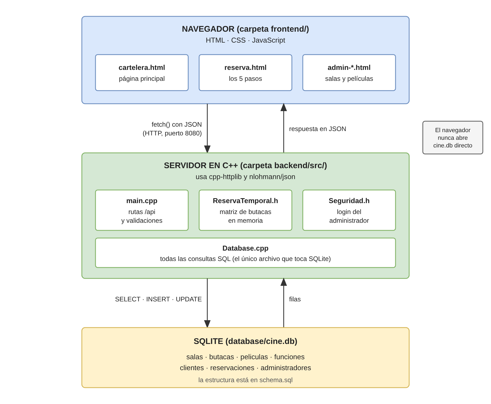
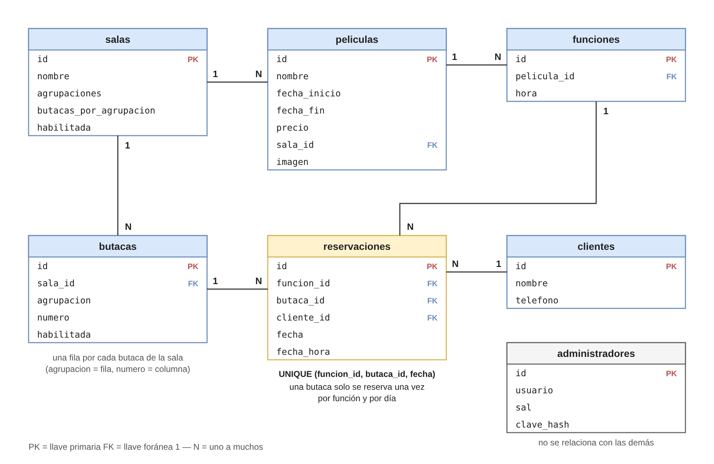
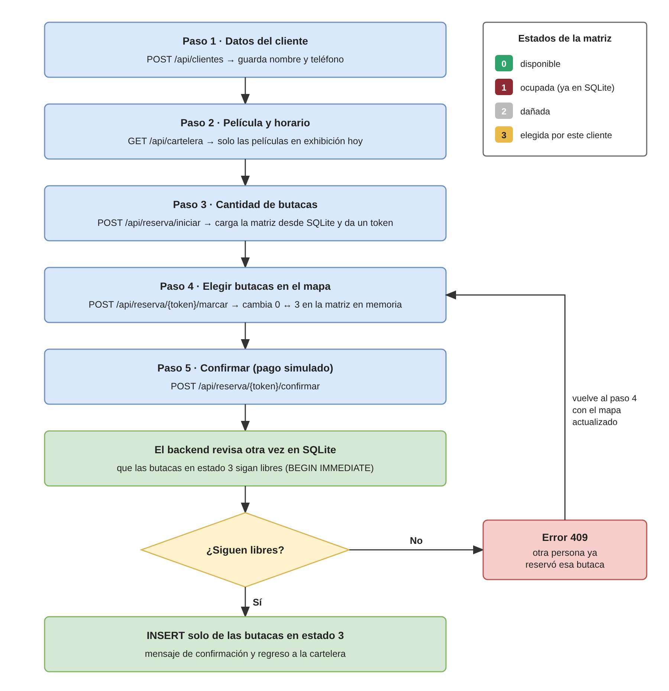

# Cinema System — Explicacion detallada del sistema

Este documento explica como funciona el sistema de cine por dentro: la arquitectura,
como se guardan y recorren los datos, como funcionan las matrices de butacas, como se
protege el panel de administracion y que hace cada pagina. Esta pensado para preparar
la defensa del examen y para que cualquier persona que lea el codigo entienda las
decisiones que se tomaron.

---

## 1. Arquitectura general

El sistema tiene tres capas separadas en carpetas:

```
Cinema-System/
├── frontend/          ← lo que ve el usuario (HTML, CSS, JavaScript)
├── backend/src/       ← el servidor en C++ que atiende peticiones
└── database/          ← la base de datos SQLite y su esquema
```

**Frontend** (carpeta `frontend/`): paginas HTML con estilos CSS y logica en JavaScript
puro. No usa ningun framework. El JavaScript hace peticiones al backend usando
`fetch()` y actualiza la pagina con lo que el servidor responde.

**Backend** (carpeta `backend/src/`): un servidor HTTP escrito en C++ usando la libreria
`cpp-httplib`. Recibe peticiones del frontend, valida los datos, consulta o modifica la
base de datos y responde en formato JSON.

**Base de datos** (carpeta `database/`): un archivo SQLite (`cine.db`). No necesita
instalar un servidor de base de datos aparte; SQLite lee y escribe directamente en el
archivo. La estructura de las tablas esta definida en `schema.sql`.

### Como se comunican

```
Navegador (frontend)  ──── HTTP (fetch) ────►  Servidor C++ (backend)
                                                      │
                                                      ▼
                                                 SQLite (cine.db)
```

1. El usuario abre una pagina (por ejemplo `cartelera.html`).
2. El JavaScript de esa pagina hace un `fetch("http://localhost:8080/api/...")`.
3. El servidor recibe la peticion, ejecuta la logica y consulta SQLite.
4. El servidor responde con un JSON.
5. El JavaScript lee el JSON y actualiza la pagina (por ejemplo, muestra las peliculas).

El servidor se compila con `compilar.bat` y se ejecuta con `iniciar.bat`, que lo
levanta en `http://localhost:8080`. La ruta `/` redirige automaticamente a
`/cartelera.html`.



---

## 2. Modelo de datos (base de datos)

La base de datos tiene 7 tablas. Aqui estan las relaciones:

```
salas 1 ── N butacas          (una sala tiene muchas butacas)
salas 1 ── N peliculas        (una pelicula se exhibe en una sala)
peliculas 1 ── N funciones    (una pelicula puede tener varios horarios)
reservaciones une: funcion + butaca + cliente + fecha
```



### Tabla por tabla

**`salas`** — Cada sala tiene un nombre, la cantidad de agrupaciones (bloques de
butacas) y cuantas butacas hay por agrupacion. Tambien tiene un campo `habilitada`
(0 o 1) para poder inhabilitarla sin borrarla.

**`butacas`** — Una fila por cada butaca fisica. Se generan automaticamente cuando se
crea una sala. Cada butaca tiene su posicion en la matriz: `agrupacion` (fila) y
`numero` (columna), ambos empezando en 0. El campo `habilitada` permite marcarla
como danada (0) sin borrarla.

**`peliculas`** — Nombre, fechas de exhibicion (inicio y fin en formato AAAA-MM-DD),
precio, la sala donde se exhibe y la ruta del poster. Las fechas se guardan como
texto porque en formato AAAA-MM-DD el orden alfabetico coincide con el orden
cronologico, asi que se pueden comparar directamente.

**`funciones`** — Cada horario de una pelicula es una funcion. Si "Inception" se pasa
a las 14:00 y a las 20:00, son dos funciones distintas. Las reservaciones se asocian a
la funcion (no a la pelicula), porque la butaca A5 puede estar libre a las 14:00 y
ocupada a las 20:00.

**`clientes`** — Nombre y telefono del cliente que reserva. Se registra en el paso 1
de la reservacion.

**`reservaciones`** — Una fila por cada butaca reservada. Si un cliente reserva 3
butacas, se insertan 3 filas. La restriccion mas importante del sistema es:

```sql
UNIQUE (funcion_id, butaca_id, fecha)
```

Esto significa que una butaca solo puede reservarse UNA vez por funcion y por dia.
Aunque el codigo del backend falle, la base de datos misma rechaza la doble
reservacion. Las reservaciones son por dia (`fecha = hoy`), asi que al dia siguiente
la misma funcion vuelve a tener todas las butacas libres.

**`administradores`** — Usuario, sal y hash de la contrasena. La contrasena nunca se
guarda directamente (ver seccion de seguridad).

### Indices

El esquema crea tres indices para que las consultas mas frecuentes sean rapidas:

- `idx_butacas_sala`: buscar butacas por sala.
- `idx_peliculas_fechas`: filtrar peliculas por periodo de exhibicion.
- `idx_reservaciones_funcion`: buscar reservaciones por funcion y fecha (la consulta
  que arma la matriz).

---

## 3. La matriz de butacas — el corazon del sistema

La matriz es lo que permite ver y modificar el estado de las butacas de una sala.
Es un arreglo de dos dimensiones:

```
matriz[agrupacion][numero] = estado
```

Donde `agrupacion` es la fila (bloque de butacas, empieza en 0) y `numero` es la
columna (butaca dentro del bloque, empieza en 0).

### Los 4 estados

| Valor | Significado | Color en pantalla | Se puede tocar? |
|-------|-------------|-------------------|-----------------|
| 0     | Disponible  | Verde             | Si: cambia a 3  |
| 1     | Ocupada (ya estaba en SQLite) | Rojo | No |
| 2     | Danada / fuera de servicio | Gris (sin color) | No |
| 3     | Seleccionada nueva (este cliente) | Amarillo (dorado #E9B949) | Si: vuelve a 0 |

El estado **3** es la clave: distingue las butacas que YA estaban reservadas por otro
cliente (estado 1, que vienen de SQLite) de las que ESTE cliente acaba de elegir
(estado 3, que solo existen en la memoria del servidor). Cuando el cliente confirma,
solo se guardan en SQLite las posiciones con estado 3.

Estas constantes estan definidas en `ReservaTemporal.h`:

```cpp
const int DISPONIBLE   = 0;
const int OCUPADA      = 1;
const int DANADA       = 2;
const int SELECCIONADA = 3;
```

### Como se arma la matriz (cargarMatriz en Database.cpp)

Cuando un cliente va a reservar, el servidor necesita saber cuales butacas estan
libres, cuales estan ocupadas y cuales estan danadas. Para esto:

1. Crea una matriz del tamano de la sala, toda en 0 (disponible).
2. Hace un `LEFT JOIN` entre la tabla `butacas` y la tabla `reservaciones`, filtrando
   por la funcion y la fecha de hoy.
3. Recorre cada butaca:
   - Si `habilitada = 0` → estado 2 (danada).
   - Si ya tiene reservacion para hoy → estado 1 (ocupada).
   - Si no tiene ninguna → se queda en 0 (disponible).

El `LEFT JOIN` es lo que permite traer TODAS las butacas de la sala incluyendo las que
no tienen reservacion (que serian las disponibles):

```sql
SELECT b.id, b.agrupacion, b.numero, b.habilitada,
       (r.id IS NOT NULL) AS ocupada
FROM butacas b
LEFT JOIN reservaciones r
       ON r.butaca_id = b.id AND r.funcion_id = ? AND r.fecha = ?
WHERE b.sala_id = ?
```

### La etiqueta de cada butaca

Para mostrarle al cliente, cada butaca se nombra con una letra (la agrupacion) y un
numero. La agrupacion 0 es "A", la 1 es "B", etc. El numero empieza en 1 (no en 0).
Entonces la posicion `(0, 4)` en la matriz es la butaca **"A5"**.

```cpp
// etiquetaButaca(0, 4) → "A5"
std::string(1, 'A' + agrupacion) + std::to_string(numero + 1)
```

---

## 4. Flujo completo de una reservacion (paso a paso)

Este es el proceso mas importante del sistema. Tiene 5 pasos y usa varias rutas de
la API.



### Paso 1: Datos del cliente

**Ruta:** `POST /api/clientes`

El cliente escribe su nombre y telefono. El backend valida que el nombre tenga al
menos 3 caracteres y que el telefono tenga exactamente 8 digitos (se aceptan espacios
y guiones pero se guardan solo los digitos). Si todo esta bien, se inserta en la tabla
`clientes` y se devuelve el `cliente_id`.

### Paso 2: Elegir pelicula y horario

**Ruta:** `GET /api/cartelera`

El frontend pide las peliculas que estan en exhibicion hoy. La consulta en el backend
filtra con:

```sql
WHERE date('now', 'localtime') BETWEEN p.fecha_inicio AND p.fecha_fin
  AND s.habilitada = 1
```

Solo salen peliculas cuya fecha de hoy esta dentro de su periodo Y cuya sala esta
habilitada. El cliente elige una pelicula y un horario (una funcion).

### Paso 3: Cantidad de butacas

**Ruta:** `GET /api/funciones/{id}/disponibles`

El frontend consulta cuantas butacas quedan libres en esa funcion para hoy. El cliente
elige cuantas quiere (de 1 a 10, y no mas de las disponibles).

**Ruta:** `POST /api/reserva/iniciar`

Con el `cliente_id`, el `funcion_id` y la `cantidad`, el servidor:

1. Valida que el cliente exista, que la funcion sea reservable (pelicula en cartelera
   y sala habilitada) y que la cantidad sea valida.
2. Carga la matriz desde SQLite (con `cargarMatriz`).
3. Verifica que haya suficientes butacas disponibles.
4. Guarda la matriz en memoria (en `ReservasEnMemoria`) y devuelve un **token** (por
   ejemplo "r1", "r2", etc.).

El token identifica esta reservacion en proceso. El navegador lo manda en cada
peticion siguiente para que el servidor sepa de cual matriz se trata. Puede haber
varios clientes reservando al mismo tiempo, cada uno con su propio token y su propia
matriz.

### Paso 4: Elegir butacas en el mapa

**Ruta:** `POST /api/reserva/{token}/marcar`

Cada vez que el cliente hace clic en una butaca, el frontend manda la posicion
(`agrupacion` y `numero`). El servidor:

1. Busca la matriz en memoria usando el token.
2. Revisa el estado de esa posicion:
   - Si es 0 (disponible) y no ha elegido todas las que pidio → cambia a 3.
   - Si es 3 (seleccionada) → cambia a 0 (la desmarca).
   - Si es 1 (ocupada) o 2 (danada) → responde 409 (no se puede tocar).
3. Devuelve el nuevo estado, cuantas lleva seleccionadas y los nombres de las
   butacas elegidas.

**Importante:** en este paso NO se toca SQLite. Solo se modifica la matriz en la
memoria del servidor. Esto es rapido y permite que el cliente cambie de opinion sin
afectar la base de datos.

### Paso 5: Confirmar y pagar

**Ruta:** `POST /api/reserva/{token}/confirmar`

Cuando el cliente confirma:

1. Se verifica que haya elegido exactamente la cantidad de butacas que pidio.
2. Se recorre la matriz con `posicionesNuevas()` y se toman SOLO las posiciones con
   estado 3 (las que este cliente eligio). Las de estado 1 ya estaban en SQLite y no
   se vuelven a insertar.
3. Se llama a `confirmarReserva()` en la base de datos.

#### La revalidacion (confirmarReserva en Database.cpp)

Este es el punto mas critico del sistema. Entre que el cliente eligio las butacas y
que dio clic en confirmar, OTRO cliente pudo haber reservado alguna de esas butacas.
Por eso:

1. Se abre una transaccion con `BEGIN IMMEDIATE` (esto bloquea la base de datos para
   escritura, asi ningun otro hilo puede insertar mientras tanto).
2. Se revisa OTRA VEZ en SQLite cada butaca:
   - Que siga habilitada (el admin pudo haberla marcado como danada).
   - Que no tenga ya una reservacion para esta funcion y fecha.
3. Si alguna butaca tiene conflicto → `ROLLBACK` (no se guarda nada) y se devuelve
   la lista de butacas en conflicto.
4. Si todo esta bien → se insertan las reservaciones y se hace `COMMIT`.

Cuando hay conflicto, el servidor responde con codigo **409** y manda la matriz
actualizada. El frontend la recarga y el cliente puede elegir otras butacas.

Ademas de la revalidacion en el codigo, la base de datos tiene el constraint:

```sql
UNIQUE (funcion_id, butaca_id, fecha)
```

Que actua como ultima linea de defensa: aunque el codigo falle, SQLite rechaza el
duplicado.

#### Despues de confirmar

- Se borra la reservacion temporal de memoria (`reservas.borrar(token)`).
- Se responde con el total a pagar, los nombres de las butacas y los datos de la
  funcion.
- El frontend muestra un mensaje de exito y redirige a la cartelera en 10 segundos.

### Cancelar

**Ruta:** `POST /api/reserva/{token}/cancelar`

Borra la matriz temporal de memoria sin guardar nada en SQLite.

### Expiracion automatica

Si el cliente abandona la pagina sin confirmar ni cancelar, la reservacion temporal se
borra sola despues de **20 minutos** (`MINUTOS_MAXIMOS` en `ReservasEnMemoria`). Esto
evita que la memoria se llene de reservaciones abandonadas.

---

## 5. Concurrencia — como maneja varios clientes a la vez

El servidor usa `cpp-httplib`, que atiende cada peticion en un **hilo** distinto.
Esto significa que dos clientes pueden estar reservando al mismo tiempo.

### En memoria (ReservasEnMemoria)

Cada operacion sobre el mapa de reservaciones temporales (crear, usar, copiar, borrar)
toma un `std::mutex` antes de hacer cualquier cosa. Esto evita que dos hilos
modifiquen el mapa al mismo tiempo.

```cpp
std::lock_guard<std::mutex> lock(mutex_);
```

### En la base de datos (Database)

Igualmente, cada metodo de `Database` toma un mutex antes de usar la conexion a
SQLite. SQLite permite una sola escritura a la vez; el mutex del lado de C++ asegura
que las sentencias preparadas no se mezclen entre hilos.

### En la confirmacion

La transaccion `BEGIN IMMEDIATE` en `confirmarReserva()` es el mecanismo que resuelve
el conflicto real: si dos clientes eligen la misma butaca y confirman casi al mismo
tiempo, el primero que llegue a `BEGIN IMMEDIATE` bloquea la base de datos. Cuando
el segundo llega, la revision detecta que la butaca ya esta ocupada y hace ROLLBACK.

**Ejemplo:**
1. Cliente A y Cliente B eligen la butaca A5 en la misma funcion.
2. Cliente A confirma primero → `BEGIN IMMEDIATE` → revisa → A5 esta libre → INSERT
   → COMMIT. Respuesta: 201 (reservado).
3. Cliente B confirma despues → `BEGIN IMMEDIATE` → revisa → A5 ya tiene reservacion
   → ROLLBACK. Respuesta: 409 con la matriz actualizada.
4. Cliente B ve la butaca A5 en rojo y elige otra.

---

## 6. Seguridad del panel de administracion

### Contrasenas (Seguridad.h)

Las contrasenas nunca se guardan tal cual. Se usa un hash SHA-256 con sal:

1. Se genera una **sal**: un texto aleatorio distinto para cada usuario (16 bytes →
   32 caracteres hexadecimales).
2. Se calcula el hash: `SHA256(sal + contrasena)`, repetido **10,000 veces**.
3. Se guarda en la base de datos solo el `usuario`, la `sal` y el `clave_hash`.

La sal hace que dos usuarios con la misma contrasena tengan hashes distintos (un
atacante no puede usar una tabla precalculada). Las 10,000 repeticiones hacen que
calcular el hash sea lento (key stretching), asi que adivinar contrasenas por fuerza
bruta toma mucho mas tiempo.

Para verificar un login:
1. Se busca el usuario en la tabla `administradores`.
2. Se calcula `hashClave(sal_guardada, contrasena_que_escribio)`.
3. Se compara con el `clave_hash` guardado usando `igualesSeguro()`, que tarda
   siempre lo mismo sin importar en que caracter falle (para evitar ataques de
   timing).

Si la contrasena es incorrecta, el servidor espera 600 milisegundos antes de
responder ("Usuario o contrasena incorrectos"), sin decir cual de los dos fallo.

### Sesiones (Bearer token)

Cuando el login es correcto:

1. Se genera un token aleatorio de 64 caracteres hexadecimales.
2. Se guarda en memoria con el nombre del usuario y la hora de vencimiento (8 horas).
3. Se responde con el token.
4. El frontend lo guarda en `localStorage` y lo manda en cada peticion admin:
   ```
   Authorization: Bearer <token>
   ```

El servidor tiene un lambda `esAdmin` que revisa si el token es valido antes de
ejecutar cualquier ruta de administracion. Si el token no existe o vencio, responde
401.

Las sesiones viven solo en memoria: si el servidor se reinicia, todas las sesiones se
borran y hay que iniciar sesion de nuevo.

### Admin inicial

La primera vez que se ejecuta el servidor, si la tabla `administradores` esta vacia,
se crea automaticamente el usuario `admin` con la contrasena `imperium2026`. Se puede
cambiar la contrasena desde la linea de comandos:

```
build\servidor.exe --cambiar-clave admin NUEVA_CLAVE
```

---

## 7. Validaciones del backend

El servidor **nunca** confia en lo que manda el navegador. Toda la informacion se
valida en el backend antes de usarla.

### Salas
- Nombre no puede estar vacio ni repetido.
- Agrupaciones: de 1 a 10.
- Butacas por agrupacion: de 1 a 60.

### Peliculas
- Nombre no puede estar vacio.
- Fechas en formato AAAA-MM-DD y que el dia exista (rechaza 2026-02-30).
- Fecha fin no puede ser antes de fecha inicio.
- Precio mayor que 0.
- Al menos un horario, en formato HH:MM (24 horas), sin repetidos.
- La sala tiene que existir y estar habilitada.

### Clientes
- Nombre de al menos 3 caracteres y maximo 60.
- Telefono de exactamente 8 digitos (se permiten espacios y guiones).

### Reservaciones
- La cantidad de butacas debe ser de 1 a 10 y no mayor que las disponibles.
- La funcion debe existir, su pelicula debe estar en cartelera hoy y la sala habilitada.
- Al marcar: la butaca debe estar dentro de la matriz, no puede estar ocupada (1)
  ni danada (2), y no se puede marcar de mas.
- Al confirmar: se revalida todo en SQLite (ver seccion de revalidacion).

### SQL injection

En ninguna parte del codigo se concatena texto del usuario en una consulta SQL.
Siempre se usan parametros (`?`) con `sqlite3_bind_*()`:

```cpp
Sentencia s(db_, "SELECT ... WHERE nombre = ?");
s.bind(1, nombre);  // seguro: SQLite escapa automaticamente
```

---

## 8. Estructura del backend — archivos y que hace cada uno

### `main.cpp` (745 lineas)

El archivo principal. Hace cuatro cosas:

1. Abre la base de datos (`Database db("database/cine.db")`).
2. Crea el servidor HTTP y sirve los archivos de `frontend/` como paginas estaticas.
3. Registra todas las rutas de la API (GET, POST, PUT).
4. Se queda escuchando en `http://localhost:8080`.

Tambien contiene las funciones de validacion (`validarSala`, `validarPelicula`,
`validarCliente`, `fechaValida`, `horaValida`), la decodificacion de imagenes base64
para los posters y la logica de cambio de contrasena por linea de comandos.

### `Database.h` / `Database.cpp` (116 + 527 lineas)

La capa de acceso a datos. La clase `Database` es la UNICA parte del programa que
habla con SQLite. Las rutas de `main.cpp` no escriben SQL: solo llaman a los metodos
de `Database`.

- **Constructor:** abre el archivo `cine.db`, activa foreign keys y crea la tabla de
  administradores si no existe.
- **CRUD de salas:** listar, obtener, crear (con transaccion que genera las butacas) y
  cambiar habilitada.
- **Butacas:** listar y cambiar habilitada.
- **Peliculas:** listar (con filtro de cartelera) y crear (con transaccion que inserta
  horarios).
- **Administradores:** obtener, contar, guardar (UPSERT).
- **Clientes:** crear y verificar existencia.
- **Reservaciones:** fechaHoy, obtenerFuncion (JOIN de 3 tablas), cargarMatriz
  (LEFT JOIN) y confirmarReserva (BEGIN IMMEDIATE + revalidacion).

La clase `Sentencia` es un envoltorio RAII sobre `sqlite3_stmt`: el constructor la
prepara y el destructor la libera, asi no se olvida cerrarla.

### `ReservaTemporal.h` (139 lineas)

La matriz en memoria. Contiene:

- **`ReservaTemporal`** (struct): la matriz, los ids de las butacas, los datos del
  cliente y la funcion. Tiene `posicionesNuevas()` que recorre la matriz y devuelve
  las posiciones con estado 3.
- **`ReservasEnMemoria`** (class): un mapa `token → ReservaTemporal` protegido con
  mutex. Crea tokens ("r1", "r2", ...), permite operar sobre una reservacion con el
  mutex tomado, y limpia reservaciones viejas despues de 20 minutos.

### `modelos.h` (120 lineas)

Un struct por cada tabla de la base de datos (`Sala`, `Butaca`, `Pelicula`, `Funcion`,
`Administrador`, `InfoFuncion`). Cada struct tiene una funcion `to_json()` que
nlohmann/json detecta automaticamente, asi se puede responder con
`responderJson(res, sala)` directamente.

### `Seguridad.h` (171 lineas)

Todo lo de autenticacion:

- `sha256()`: implementacion del algoritmo SHA-256 (FIPS 180-4).
- `textoAleatorio()`: genera texto hexadecimal aleatorio (para sales y tokens).
- `hashClave()`: calcula `SHA256(sal + clave)` repetido 10,000 veces.
- `igualesSeguro()`: comparacion en tiempo constante.
- `SesionesAdmin`: clase que maneja las sesiones con tokens Bearer de 8 horas.

---

## 9. Paginas del frontend — que hace cada una

### `cartelera.html` — Pagina principal

**Lo que ve el usuario:** las peliculas que estan en exhibicion hoy, con poster,
nombre, horarios y precio. Al hacer clic en una pelicula se abre un pop-up con los
detalles y un boton para reservar.

**JS:** `cartelera.js` pide `GET /api/cartelera` y construye las tarjetas. El carrusel
muestra los posters completos sobre un fondo difuminado.

### `reserva.html` — Proceso de reservacion

**Lo que ve el usuario:** un formulario en pasos (nombre/telefono → cantidad → mapa
de butacas → confirmacion).

**JS:** `reserva.js` (593 lineas) maneja todo el flujo:
- Paso 1: valida y manda `POST /api/clientes`.
- Paso 2: la pelicula y funcion vienen por URL. Pide `GET /api/funciones/{id}/disponibles`.
- Paso 3: el usuario elige cuantas butacas. Manda `POST /api/reserva/iniciar` y
  recibe el token y la matriz.
- Paso 4: dibuja la cuadricula de butacas con colores segun el estado. Cada clic
  manda `POST /api/reserva/{token}/marcar` y actualiza los colores.
- Paso 5: manda `POST /api/reserva/{token}/confirmar`. Si hay conflicto (409),
  recarga la matriz. Si todo sale bien, muestra el mensaje de exito.

### `admin-login.html` — Login del administrador

**Lo que ve el usuario:** un formulario con usuario y contrasena.

**JS:** `admin-login.js` manda `POST /api/login`. Si es correcto, guarda el token en
`localStorage` y redirige al panel. `admin-sesion.js` se incluye en todas las paginas
admin: revisa que el token siga vigente (`GET /api/sesion`) y si no, redirige al login.

### `admin-salas.html` — Gestion de salas

**Lo que ve el usuario:** la lista de salas con su nombre, agrupaciones y butacas.
Puede crear salas nuevas, habilitar/inhabilitar salas y ver el mapa de butacas para
marcar las danadas.

**JS:** `admin-salas.js` usa:
- `GET /api/salas` para listar.
- `POST /api/salas` para crear.
- `PUT /api/salas/{id}/habilitada` para habilitar/inhabilitar.
- `GET /api/salas/{id}/butacas` para ver el mapa.
- `PUT /api/butacas/{id}/habilitada` para marcar danada/reparar.

### `admin-peliculas.html` — Gestion de peliculas

**Lo que ve el usuario:** la lista de peliculas registradas y un formulario para
crear una nueva (nombre, fechas, precio, sala, horarios y poster).

**JS:** `admin-peliculas.js` usa:
- `GET /api/peliculas` para listar todas.
- `GET /api/salas` para llenar el select de salas.
- `POST /api/peliculas` para crear (la imagen se manda como base64 dentro del JSON).

---

## 10. Librerias externas

El proyecto usa dos librerias en C++ que son archivos de un solo header (no necesitan
compilarse aparte):

- **cpp-httplib** (`httplib.h`): servidor HTTP ligero. Permite registrar rutas (GET,
  POST, PUT), servir archivos estaticos y manejar peticiones en hilos.
- **nlohmann/json** (`json.hpp`): manejo de JSON en C++. Permite parsear el cuerpo de
  las peticiones y serializar los structs a JSON automaticamente con `to_json()`.
- **SQLite** (`sqlite3.h` / `sqlite3.c`): la base de datos. Se compila junto con el
  servidor (no es un servicio externo).

---

## 11. Decisiones tecnicas y por que se tomaron

**Por que SQLite y no MySQL/Postgres?**
El examen lo pide. Ademas, SQLite no necesita instalar nada, es un solo archivo y
funciona bien para un sistema local.

**Por que la matriz vive en memoria y no en SQLite?**
Mientras el cliente elige butacas (puede cambiar varias veces), seria muy lento y
complicado estar insertando y borrando filas en SQLite con cada clic. La matriz en
memoria es instantanea. Solo al confirmar se guarda todo de una vez.

**Por que el estado 3 en vez de solo tener libre/ocupada?**
Porque necesitamos saber cuales butacas eligio ESTE cliente para poder insertarlas en
SQLite al confirmar. Sin el estado 3, no podriamos distinguir "esta butaca ya estaba
reservada por otro" (1) de "esta butaca la acaba de elegir este cliente" (3).

**Por que BEGIN IMMEDIATE en vez de solo BEGIN?**
`BEGIN` normal permite que otros hilos lean mientras tanto, pero podrian leer datos
que van a cambiar. `BEGIN IMMEDIATE` reserva el derecho a escribir desde el inicio:
si otro hilo ya tiene una transaccion, el segundo espera. Esto evita deadlocks y
asegura que la revalidacion sea confiable.

**Por que se revalida si ya esta el UNIQUE?**
El UNIQUE rechaza el INSERT con un error, pero a esa altura ya perdimos el control.
Con la revalidacion, podemos hacer ROLLBACK limpio, informar al cliente CUALES butacas
tuvieron conflicto y mandarle la matriz actualizada. Es una mejor experiencia.

**Por que tokens en vez de cookies?**
Los tokens Bearer son mas simples de manejar en una API REST. No hay problemas de
CORS con cookies ni de sesiones del lado del servidor que dependan del navegador.

**Por que las reservaciones son por dia?**
La misma funcion puede repetirse cada dia. La butaca A5 ocupada hoy a las 20:00 puede
estar libre manana a las 20:00. El campo `fecha` en `reservaciones` permite esto.

**Por que las butacas se nombran A1, B3 y no fila-columna?**
Es mas natural para el usuario. La letra identifica la agrupacion (bloque) y el
numero la butaca dentro del bloque. Es lo que se usa en cines reales.

**Por que se guardan los posters como archivos y no en la base de datos?**
Las imagenes pueden ser grandes (hasta 3 MB). Guardarlas en SQLite como BLOB haria
la base de datos muy pesada y las consultas mas lentas. En cambio, se guarda solo la
ruta y el archivo va en `frontend/img/peliculas/`.

---

## 12. Preguntas frecuentes para la defensa

**P: Como se aseguran de que dos personas no reserven la misma butaca?**
R: Con tres mecanismos: la revalidacion en `confirmarReserva()` con `BEGIN IMMEDIATE`
revisa otra vez en SQLite antes de insertar; si hay conflicto responde 409. Ademas, el
constraint `UNIQUE(funcion_id, butaca_id, fecha)` en la tabla `reservaciones` actua
como ultima barrera. Y el mutex en C++ evita que dos hilos usen la conexion a SQLite
al mismo tiempo.

**P: Que pasa si el cliente cierra el navegador sin confirmar?**
R: La reservacion temporal se borra sola de memoria despues de 20 minutos
(`MINUTOS_MAXIMOS = 20`). Las butacas que habia seleccionado vuelven a estar
disponibles. No se guardo nada en SQLite.

**P: Que pasa si el servidor se reinicia?**
R: Las reservaciones en proceso se pierden (solo vivian en memoria), pero las
confirmadas persisten en SQLite. Las sesiones del admin tambien se borran y hay que
iniciar sesion de nuevo.

**P: Se puede hackear la contrasena del admin?**
R: Es muy dificil. La contrasena se guarda como hash SHA-256 con sal aleatoria y
10,000 iteraciones. No se puede revertir un hash. Si alguien intenta adivinar por
fuerza bruta, cada intento toma tiempo por las iteraciones y el delay de 600ms en el
login.

**P: Por que las fechas se guardan como texto?**
R: Porque en formato AAAA-MM-DD el orden alfabetico coincide con el orden
cronologico. Entonces se pueden comparar con `<`, `>`, `BETWEEN` directamente, sin
funciones especiales.

**P: Que valida el backend que el frontend no?**
R: TODO. El backend no confia en el frontend. Un atacante podria mandar peticiones
directamente sin usar las paginas. El backend valida: formato de fechas, rangos
numericos, que las salas existan, que las peliculas esten en cartelera, que el
telefono tenga 8 digitos, que no se inyecte SQL, que el token de admin sea valido.

**P: Que es RAII?**
R: Resource Acquisition Is Initialization. Es la tecnica de C++ donde un objeto
adquiere un recurso al crearse (constructor) y lo libera al destruirse (destructor).
La clase `Sentencia` la usa: el constructor prepara la sentencia SQL y el destructor
la libera con `sqlite3_finalize()`. Asi nunca se olvida liberar el recurso, incluso
si hay una excepcion.

**P: Que es un mutex?**
R: Un candado que asegura que solo un hilo a la vez pueda ejecutar un bloque de
codigo. Se usa `std::lock_guard<std::mutex>` que toma el candado al crearse y lo
suelta automaticamente al salir del bloque (tambien es RAII).

**P: Que es un LEFT JOIN?**
R: Un tipo de JOIN que trae TODAS las filas de la tabla izquierda, aunque no tengan
coincidencia en la tabla derecha. Se usa en `cargarMatriz`: trae todas las butacas de
la sala, y para las que no tienen reservacion, las columnas de `reservaciones` salen
como NULL. Asi sabemos cuales estan libres.

---

## 13. Documentacion existente en docs/

| Archivo | Que contiene |
|---------|-------------|
| `rutas-api.md` | Lista de todas las rutas HTTP de la API con sus parametros y respuestas |
| `Guia_de_estilo_Cinema_System.pdf` | Colores, tipografia y reglas visuales del proyecto |
| `arquitectura.png` | Diagrama de la arquitectura (frontend → backend → SQLite) |
| `flujo-reserva.png` | Diagrama del flujo de reservacion paso a paso |
| `modelo-datos.png` | Diagrama de las tablas y sus relaciones |
| `capturas/` | Capturas de pantalla de las paginas del sistema |
| `explicacion-del-sistema.md` | Este documento |

---

## 14. Como compilar y ejecutar

**Requisitos:** Windows con MSYS2 (g++ UCRT64).

1. Abrir la terminal en la carpeta raiz del proyecto.
2. Compilar: `.\compilar.bat`
3. Ejecutar: `.\iniciar.bat`
4. Abrir en el navegador: `http://localhost:8080`

Para detener el servidor: `Ctrl + C` en la terminal.

Si se hacen cambios solo en el frontend (HTML, CSS, JS), no hace falta recompilar:
basta con recargar la pagina con `Ctrl + F5`.

Si se hacen cambios en el backend (archivos .cpp o .h), hay que detener el servidor
(`Ctrl + C`), recompilar y volver a ejecutar.